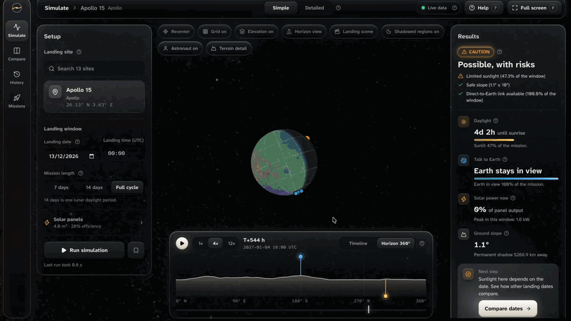

<p align="center">
  
</p>

<h3 align="center">
  <a href="https://naples-perry-medicare-springs.trycloudflare.com/?tour=1">▶ Try the live demo</a>
</h3>
<p align="center">Opens the console with the guided tour, against the real simulation server. No install needed.</p>

# Balam · Lunar Landing Navigator Console

**Pick a place and a date on the Moon, and in a few seconds learn whether it is a good place to land, and why.**

Balam is our NASA Space Apps project. This repo is its **console**, the web app people use. It sits on top of a live 3D Moon and answers three questions for any landing site and date:

| Question | Why it matters | What the console shows |
| --- | --- | --- |
| ☀️ **Will there be sunlight?** | Solar panels are the lander's power | How long until sunset, the share of the mission in daylight, and the solar power right now |
| 🌍 **Will Earth be in view?** | A direct radio link needs Earth above the local horizon | How long Earth stays visible, and when it sets |
| ⛰️ **Is the ground safe?** | Steep slopes tip landers over | The ground slope and the verdict's safety check |

The answer is a clear verdict, **GO**, **CAUTION** or **NO-GO**, with its reasons, plus a replay of the whole stay: the Sun and Earth moving across the real horizon of that site.

> **The console draws; it does not invent.** Every verdict, number, Sun and Earth position and shadow region comes from the simulation server, which uses NASA data (LRO LOLA terrain and JPL ephemerides). The few illustrative pieces, such as the landing animation, are labelled on screen. [What is real and what is illustrative](#what-is-real-and-what-is-illustrative) has the full list.

---

## Contents

- [A session in 60 seconds](#a-session-in-60-seconds)
- [The screen](#the-screen)
- [The four workspaces](#the-four-workspaces): Simulate, Compare, History, Missions
- [The timeline and Horizon 360°](#the-timeline-and-horizon-360)
- [The 3D Moon and its views](#the-3d-moon-and-its-views): Horizon view, Landing scene, Terrain detail…
- [Simple and Detailed](#simple-and-detailed)
- [Learning as you go](#learning-as-you-go): the tour, the "?" tips, Help, Next step
- [Use cases](#use-cases)
- [What is real and what is illustrative](#what-is-real-and-what-is-illustrative)
- [What is saved, and where](#what-is-saved-and-where)
- [Known limits](#known-limits)
- [Run it locally](#run-it-locally)
- [Related repos and docs](#related-repos-and-docs)

---

## A session in 60 seconds

```
 Pick a site ──► Set date & length ──► Run simulation ──► Read the verdict ──► Scrub the timeline ──► Compare options
 (search, globe     (e.g. 14 days =       (the server        (GO / CAUTION /      (Sun and Earth move     (up to 5 sites
  click, or a        one lunar day)        computes the       NO-GO + reasons)     over the real horizon)  or dates, A–E)
  real mission)                            whole stay)
```

1. **Open the console.** The whole Moon turns slowly in the background, with the 13 catalogue sites as dots. On the first visit, a 7-step tour offers to show the basics.
2. **Pick a site.** Search the catalogue, click a dot (or anywhere) on the Moon, or replay a real landing from Missions. The globe flies there.
3. **Set the landing date and how long the mission lasts**: 7 days, 14 days or a full lunar cycle (29.5 days).
4. **Run the simulation.** The verdict, its reasons and the key numbers appear on the right. Meanwhile the camera drops from orbit to the ground of the site (**Horizon view**), so you see the sky over the real horizon.
5. **Play or drag the timeline.** The Sun and Earth move across the sky, the ground brightens and darkens, and the "now" numbers update. This is instant: the whole stay was computed in one go.
6. **Compare alternatives**, such as the same site a week later or a different site, and see which wins.
7. **Come back later.** Every run and comparison is already in **History**.

---

## The screen

One screen, no scrolling. The Moon fills the background and glass panels float on top.

| Area | What is there |
| --- | --- |
| **Left rail** | The four workspaces: **Simulate**, **Compare**, **History**, **Missions**. Switching workspace never resets the Moon behind |
| **Top bar** | Where you are and the chosen site, the **Simple / Detailed** switch, the data status (**Live data**, **Degraded** or **Offline**), **Help** and **Full screen** |
| **Left panel** | What you set up (in Simulate, *Setup*) |
| **Right panel** | What came back (in Simulate, *Results*) |
| **Scene pills** | Small buttons above the Moon that change what the globe shows ([see below](#scene-pills)) |
| **Timeline** | At the bottom, after a run: play, speed and the Sun and Earth tracks |

**Full screen** (button or the **F** key) hides the rail and folds every panel into a slim strip, leaving the Moon almost alone. Hovering a strip opens its panel again. The timeline waits a second before folding back, so a brief slip of the mouse doesn't close it.

---

## The four workspaces

### Simulate: evaluate one site and date

**Setup (left)**

| Control | What you can do |
| --- | --- |
| **Landing site** | Search the 13 sites by name (keyboard friendly), or click the globe. In Detailed, switch to **Custom** and type any latitude and longitude |
| **Landing date** and **Landing time (UTC)** | When the lander touches down; the simulation starts there |
| **Mission length** | 7 days, 14 days, or **Full cycle** (29.5 days, one lunar day and night) |
| **Time step** *(Detailed)* | Sample every 15, 60 or 120 minutes. Shorter steps catch brief sunsets; longer ones are faster |
| **Solar panels** | Panel area (m²) and efficiency (%). They change the power estimate only, never the verdict |
| **Run simulation** | Computes the whole stay. It takes a fraction of a second |
| **Star** | Marks the current run as important in History (the run is saved anyway) |

If you change anything after running (site, date, length…), the results dim and say **Out of date**, so nobody reads numbers for the wrong setup.

**Results (right)**

| Block | What it tells you |
| --- | --- |
| **Verdict** | **GO** (green), **CAUTION** (amber) or **NO-GO** (red), with a plain headline such as "A good place to land". The server decides it |
| **Reasons** | One line per check the server made, for example *Safe slope (1.1° ≤ 10°)*, *High sunlight (88.1% of the window)*, *Direct-to-Earth link available (100.0% of the window)* |
| **Daylight** | Time until the Sun next sets (or rises), and the share of the mission in direct sunlight |
| **Talk to Earth** | The same for Earth. Earth never in view means the mission would need a relay satellite |
| **Solar power now** | The panel output at the moment selected on the timeline, and the peak over the mission |
| **Ground slope** and **Permanent shadow** | How tilted the ground is, and how far the nearest permanently shadowed region (possible water ice) is |
| **Sun and Earth table** *(Detailed)* | Visible or not, direction, height, terrain horizon and clearance, at the selected moment |
| **Next step** | One suggestion for what to do now, with its button: *Compare dates*, *Change site*, *Run again*… |

### Compare: several options side by side

Add **2 to 5 scenarios** (a site on a date), press **Compare scenarios**, and get a ranked table.

| Control | What you can do |
| --- | --- |
| **Site + Landing date + Add scenario** | Build the list. The same site and date can't be added twice |
| **Compare scenarios** | Evaluate them all at once on the server |
| **Eye** | Make that scenario the active simulation: the globe and the timeline switch to it |
| **Trash** | Remove it |
| **Recommended** | Which one wins and why. The verdict ranks first (GO beats CAUTION beats NO-GO), then sunlight and Earth link |
| **Rank by** | The tie-breaker: *Balanced*, *Sunlight* or *Earth link* |
| **Side by side** | Simple: 4 plain rows (Daylight, Talk to Earth, First sunset, Ground slope). Detailed: 11 rows with every figure |

On the globe, each scenario shows as a lettered marker **A–E**, coloured by its verdict, with the recommended one highlighted.

> **Tip:** the same site on two dates shows what a launch slip costs. *Compare dates* in Next step does it for you: the chosen date, +7 and +14 days.

### History: everything you ran

Every **simulation** (from Simulate and Missions) and every **comparison** is saved automatically. Running the same thing again doesn't duplicate it; it moves back to the top.

| Control | What you can do |
| --- | --- |
| **Search** and **All / Starred / GO / NO-GO** | Find a run or a comparison |
| **Star** and **Note** | Flag what matters and write down why |
| **Open in Simulate** | Load a run and compute it again |
| **Duplicate and edit** | Load its settings to tweak them first |
| **Add to Compare** | Send the run to the comparator |
| **Open in Compare** | Reload a saved comparison and compare it again |
| **Delete** | Remove a run or a comparison |

### Missions: real landings, replayed

Seven real landings with date, coordinates, summary and cited sources: **IM-1 Odysseus, IM-2 Athena, Chandrayaan-3, Chang'e 4, Apollo 11, Apollo 15, Apollo 17**. Filter by region (south pole, near side, far side).

- **Replay landing window** evaluates 14 days from the hour of the real touchdown.
- **Conditions at touchdown** shows the Sun, Earth and slope at that first moment, with the verdict and its reasons.
- If the mission record and the simulation disagree (for example, on Earth visibility), a note says so. It doesn't pick a side.

It is a way to check the model against history.

---

## The timeline and Horizon 360°

After a run, the timeline holds **the whole stay, already computed**. Moving it never asks the server again.

| Part | What it does |
| --- | --- |
| **Play / Pause** and **1× · 4× · 12×** | Watch the stay go by |
| **Clock** | Mission time (*T+N h*) and the UTC date and time |
| **Tracks** | *Sunlight*, *Earth link* and *Sun + Earth*, each with its percentage. Flags mark sunsets and Earthsets |
| **Scrubber** | Drag it, or use the keyboard: ← → one step, PgUp PgDn one day, Home End the ends |
| **Timeline / Horizon 360°** | Switch the bottom view between the tracks and the **horizon unrolled from north to north**, with the Sun and Earth as dots. A dot below the line is hidden behind the terrain |

As you move it, the "now" numbers in Results, the Sun and Earth in the 3D sky and the brightness of the ground all follow.

---

## The 3D Moon and its views

The Moon is always there behind the panels. Rotate, zoom and fly over it with a mouse or trackpad. It uses NASA imagery (LROC) and laser altimetry (LOLA), with the south pole shown as shaded relief.

| View | How you get there | What you see |
| --- | --- | --- |
| **Global view** | On start, or with **Recenter** | The whole Moon turning slowly, the catalogue sites, and, once a date is set, the Sun, Earth and the large shadowed regions at the pole |
| **Over the site** | Picking a site | A short flight to about 120 km above it |
| **Horizon view** | Opens by itself after **Run simulation**, or via its pill | The camera descends to the ground and looks at the sky over the site's **real horizon**. The Sun and Earth (with its true phase) move with the timeline and disappear behind ridges. **Back to globe** returns |
| **Landing scene** | The **Landing scene** pill | An *illustrative* descent: the lander comes down from 600 m with engine plume and dust, touches down, and an astronaut steps out. **Exit scene** leaves |
| **Terrain detail** | The **Terrain detail** pill | A close-up 12 × 12 km patch around the site with shadows cast by the relief, colour by slope (with its scale), the Sun and Earth at true size, and **Vertical ×1 / ×2 / ×4** exaggeration (always labelled) |

### Scene pills

The pills above the Moon change what it shows. Hover any pill for a second and a bubble explains what it does.

| Pill | What it does |
| --- | --- |
| **Recenter** | Back to the whole Moon, keeping the chosen site |
| **Grid** | Latitude and longitude lines (global view) |
| **Elevation** | A colour map of terrain height (global view) |
| **Shadowed regions** | Show or hide the permanently shadowed regions (blue) |
| **Horizon view** · **Landing scene** · **Terrain detail** | Open the views above (after a run) |
| **Astronaut** | Whether the astronaut appears in the landing scene |
| **Back to globe** · **Exit scene** · **Global view** | Leave the current view |

---

## Simple and Detailed

One switch, two audiences, **the same simulation**.

| | Simple | Detailed |
| --- | --- | --- |
| **For** | The public, educators, judges | Mission planners and engineers |
| **Language** | Plain words: *Daylight*, *Talk to Earth*, "A good place to land" | Technical terms and more decimals |
| **Setup** | Site, date, length, panels | Plus custom coordinates and the time step |
| **Results** | Verdict, reasons, the key numbers | Plus the Sun and Earth table: azimuth, elevation, terrain horizon, clearance |
| **Compare** | 4 plain rows | 11 rows, UTC times, coordinates and the ranking rule |
| **Horizon view labels** | Just "Sun" and "Earth" | Plus angles and clearance above the terrain |

The verdict and the timeline are identical in both.

---

## Learning as you go

| Aid | What it is |
| --- | --- |
| **Guided tour** | 7 short steps: welcome → *Where, when, run* (it offers **Try Apollo 15** on Dec 13, 2026 and runs it for real) → the verdict → time as the main control → seeing the site from the ground → Simple vs Detailed → where to go next. It opens on the first visit only; skip it any time, replay it from Help, or force it with `?tour=1` (the [live demo](https://naples-perry-medicare-springs.trycloudflare.com/?tour=1) link does this) |
| **"?" tips** | Next to almost every term and number: one sentence, sometimes with a value to try |
| **Help** (button or **?**) | The full glossary by topic (Setup, Verdict, Sun and power, Earth link, Terrain, Time, Views, Compare), the keyboard shortcuts and *Take the tour* |
| **Pill bubbles** | Hover a scene pill for a second to learn what it shows or hides |
| **Next step** | In every workspace, one suggestion of what to do now, with its button |

**Keyboard:** **F** full screen · **?** Help · **Esc** close a popup or the tour · arrows and Enter in the site search · ← → PgUp PgDn Home End on the timeline.

---

## Use cases

| Who | What they do with it |
| --- | --- |
| **Mission planner** | Shortlist south-pole sites, then compare launch dates to see how many hours of sunlight and Earth link a delay costs |
| **Engineer** | Read the per-step Sun and Earth geometry in Detailed, check the clearance over the horizon and the solar power profile for their panel size |
| **Educator / student** | Watch why the poles are hard: the Sun skimming the horizon, long shadows, Earth hiding behind ridges |
| **History buff** | Replay Apollo 11, Chang'e 4 or IM-1 and see the light and Earth view the crews and landers actually had |
| **Judge / first-time visitor** | Take the tour and get a real verdict in under a minute without reading anything |

---

## What is real and what is illustrative

| Real (from the server or NASA) | Illustrative (labelled or explained on screen) |
| --- | --- |
| The verdict and every reason | The landing descent, its altitude and speed readouts |
| Sunlight and Earth-link times and percentages | The lander model (a generic Apollo LM) and the astronaut |
| Sun and Earth positions at every step | The fine regolith texture at ground level |
| The horizon silhouette | The light on the shaded-relief south pole and on the ground in Horizon view (the Sun's azimuth is real) |
| Terrain height and slope | The vertical exaggeration in Terrain detail |
| Permanently shadowed regions | Earth's texture and rotation (its position and phase are real) |
| Surface imagery | |

**About solar power:** it is computed for a **vertical panel that tracks the Sun**, the usual design at the south pole. With the Sun hidden it is zero; when the Sun clears the ridge it jumps to about half, because the Sun counts as visible only once its centre is above the crest.

---

## What is saved, and where

| What | Where | Notes |
| --- | --- | --- |
| Runs and comparisons (History) | This browser only | Saved automatically. Up to 100 runs and 50 comparisons. Another port or domain has its own history. No accounts |
| Whether you saw the tour | This browser | `?tour=0` hides it without changing anything |
| Current site, date, Compare scenarios | Memory | Gone on reload |
| The computations | The server | It keeps nobody's runs |

---

## Known limits

- **Away from the pole the terrain is smooth**: the global data is about 474 m per point, so the Apollo sites look almost flat up close.
- **Horizon view doesn't cast shadows from one mountain onto another**; the server shades the relief but doesn't compute those shadows.
- **The south pole** shows a small radial "burst" right at the pole, a side effect of mapping a sphere onto a latitude–longitude grid.
- **Nearest permanent shadow** is shown for every site, but it is only meaningful near the pole.
- It is built for **desktop, full screen**, as used in the live demo.

---

## Run it locally

You need Node 22 and the URL of the simulation server.

```bash
npm install
cp .env.example .env.local   # set VITE_API_BASE_URL (and VITE_GLOBE_URL for the 3D Moon)
npm run dev                  # http://localhost:5173
```

| Command | What it does |
| --- | --- |
| `npm run dev` | Start the console |
| `npm run test` · `typecheck` · `lint` | Checks |
| `npm run build` | Production build |

The 3D Moon runs from its own repo ([`luna-render-nasa-space-challenge`](https://github.com/CarlitooooK/luna-render-nasa-space-challenge), port 5174). Without it, the console still works, with a starfield background and the local terrain view. If the server goes down, an indicator explains it and the console retries every 20 seconds.

---

## Related repos and docs

| Need | Where |
| --- | --- |
| The 3D Moon (CesiumJS) | [`luna-render-nasa-space-challenge`](https://github.com/CarlitooooK/luna-render-nasa-space-challenge) |
| Project specs, API contract, decisions | [`handoff-space-NASA-challenge`](https://github.com/CarlitooooK/handoff-space-NASA-challenge) |
| How the console works inside: architecture, renders, API use, globe bridge, every screen and control (in Spanish) | [`docs/`](docs/README.md) |
| Rules for contributors and AI agents | [`CLAUDE.md`](CLAUDE.md) |

**Data and credits:** NASA LRO LOLA (terrain), NASA LROC via Moon Trek (imagery), NASA/JPL ephemerides (Sun and Earth), NASA PGDA (permanently shadowed regions), NASA 3D Resources (lander and astronaut models). Attribution is shown inside the console as well.
